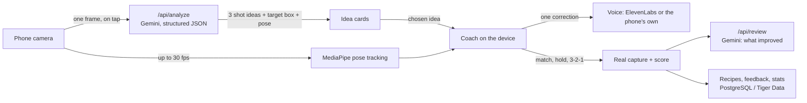

# Framewise

**A camera coach in your phone's browser.** Point it at any scene, pick one of three shots it suggests, and it coaches both the photographer and the person in the photo, live and by voice, until the shot matches. Then it takes the photo and shows you what improved.

Built at UNIHACK 8, Timișoara (13–15 November 2026), by team Civicore · track *Solve Your Own Problem*.

## The problem

Most photos of us are taken by someone else: a friend, a stranger, a phone propped on a wall. They come out badly not for lack of a good camera, but because nobody knows **where to stand, how to pose, or how to frame** for that particular place and light. Advice online is generic, and the person being photographed can't see the screen.

## What it does

1. **Read.** Open it in any phone browser, nothing to install, and point the camera at the scene.
2. **Suggest.** Gemini reads the light, background and free space and proposes **three different shots for this exact scene**, each naming what it uses ("window light from the left", "plain wall") and what to keep out of frame.
3. **Coach.** Pick one. The phone tracks the body **on the device**, up to 30 times a second, compares the pose and position with the shot, and gives **one correction at a time**: on screen for the photographer, spoken for the person posing, in English or Romanian. Solo mode works with the phone propped up.
4. **Capture.** When pose and framing match, it says "hold", counts down and takes the photo itself. **The photo is always a real capture, never generated or edited.**
5. **Learn and share.** You see before and after with a score and what improved. A good shot can be published as a **recipe**: a link and QR code that coach the next person to recreate it.

## How it works



- **Planning (Gemini).** The model must answer with JSON that matches a strict schema (`src/lib/contracts.ts`), including the target box the coach steers toward. The answer is validated, retried once with the validation errors, and falls back to a second fast model when the first is overloaded. Sample data is always labelled as such.
- **Coaching (on the device).** Pose matching uses joint angles, so it doesn't matter how far away the person stands. Framing compares the body's position and size with the target box. A rules engine picks the single most useful correction, waits until it is stable before switching, paces what it says, and never repeats itself straight away.
- **Voice (ElevenLabs).** Corrections are spoken with ElevenLabs text-to-speech (Flash v2.5, English and Romanian), falling back to the phone's own voice. An optional voice conversation lets you say "next idea", "pause" or "take it", through the same safe paths as the buttons.
- **Data (PostgreSQL / Tiger Data).** Usage numbers, feedback and recipes are stored in PostgreSQL. With TimescaleDB available, coach events become a hypertable. Without a database the app uses clearly labelled temporary storage.
- **Honest results.** `/stats` shows only measured numbers per app version (sessions, time to match, score gain, ratings) and says "not measured" instead of inventing zeros.

## Try it

| Page | What it shows |
|---|---|
| `/shoot` | The app: camera, ideas, coaching, result |
| `/demo` | The whole flow on a drawn scene with no camera, network or AI (labelled as a demo) |
| `/recipes`, `/r/<id>` | Shared shot recipes with QR codes |
| `/stats` | Results from user testing, by app version |
| `/lab` | Developer pages: the pose library, live tracking, single-picture tests |

## Privacy

- A photo leaves the phone only when you tap **Read my scene**, and for the before/after review. Photos are not stored.
- The coach talks about **pose, light and framing only**, never about bodies or looks.
- Feedback and usage numbers contain no personal data. Recipe locations are optional and rounded.

## Run it

```bash
npm install
```

```bash
cp .env.example .env.local
```

```bash
npm run dev
```

Every key is optional; without them the app runs on labelled sample data. See [docs/SETUP.md](docs/SETUP.md) for keys and storage, and [docs/DEPLOY-VULTR.md](docs/DEPLOY-VULTR.md) to put it on a Vultr server with HTTPS. Phones only open the camera on HTTPS or `localhost`.

`npm run check` runs types, lint, tests and the production build.

## More

- [Architecture](docs/ARCHITECTURE.md): modules, contracts and how the coach is used from a screen.
- [Credits](docs/CREDITS.md): every library, API and model we used.
- Status boards: [`docs/status/`](docs/status/).

The pose library and all coach phrases were written by the team during the event. No third-party pose data or photos are used.
