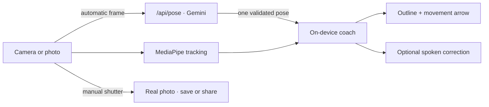

# Framewise

**A simple camera with live pose guidance.** Open the camera, follow the outline and movement arrow, and press the shutter. No idea cards, analysis button or results questionnaire.

Built at UNIHACK 8, Timișoara (13–15 November 2026), by team Civicore · track *Solve Your Own Problem*.

## What it does

1. Opens directly into the camera, with a photo-upload fallback.
2. Gemini chooses **one pose** from the current frame, based on the visible person, light, posture and setting.
3. MediaPipe tracks the body on the device. A light outline and one arrow show where to move; the outline turns green when the pose matches.
4. The shutter takes an unedited photo whenever you choose. Tap its thumbnail to save or share it.

Icon controls toggle pose guidance, optional spoken corrections, a composition grid and the front/rear camera. The preview preserves the source aspect ratio, including in landscape. Guidance never triggers an automatic capture in the main camera.

## How it works



The chosen pose stays steady while you follow it. Every 20 seconds a small local image comparison checks for a changed scene; only a changed scene, an empty scene or a failed request triggers another server request. If Gemini is unavailable, the camera keeps working and the guidance icon indicates the problem. It never silently substitutes a sample pose.

## Try it

| Page | What it shows |
|---|---|
| `/`, `/shoot` | The simplified pose camera |
| `/demo` | The same camera UI on a labelled sample scene, with a fixed sample target and no Gemini calls; tracking assets may require a download |
| `/recipes`, `/r/<id>` | Existing shared recipes and their separate recreation flow |
| `/stats` | Existing coaching measurements; the new direct shutter does not yet report capture outcomes here |
| `/lab` | Developer pages for the pose library and tracking |

## Privacy

- While guidance is enabled, a reduced frame is sent automatically to Gemini to choose a pose. Turn off the person icon to stop those requests. Photos are not stored by this app's pose endpoint.
- Continuous body tracking runs on the device. Backgrounding the page or opening the captured-photo preview stops the camera and guidance requests.
- Captured photos stay in memory on the device until you save/share them. Download photos you want to keep before closing the page.
- The camera requests no microphone access. Optional spoken corrections use the existing ElevenLabs/device voice path.
- Keys and database credentials belong in ignored `.env.local` or server environment variables, never Git.

## Run it

```bash
npm install
```

```bash
cp .env.example .env.local
```

```bash
npm run dev
```

Every key is optional; without them the app runs on labelled sample data. See [docs/SETUP.md](docs/SETUP.md) for keys and storage, and [docs/DEPLOY-VULTR.md](docs/DEPLOY-VULTR.md) to put it on a Vultr server with HTTPS. Phones only open the camera on HTTPS or `localhost`.

`npm run check` runs types, lint, tests and the production build.

## More

- [Architecture](docs/ARCHITECTURE.md): modules, contracts and how the coach is used from a screen.
- [Credits](docs/CREDITS.md): every library, API and model we used.
- Status boards: [`docs/status/`](docs/status/).

The pose library and all coach phrases were written by the team during the event. No third-party pose data or photos are used.
